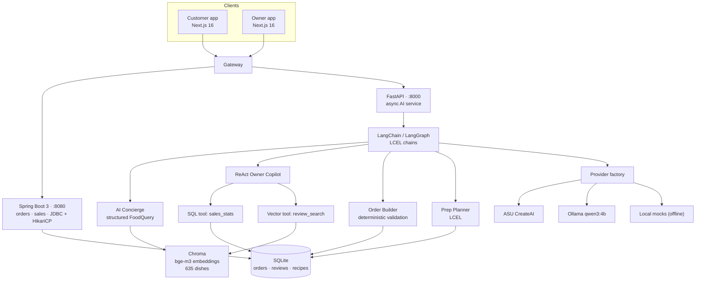
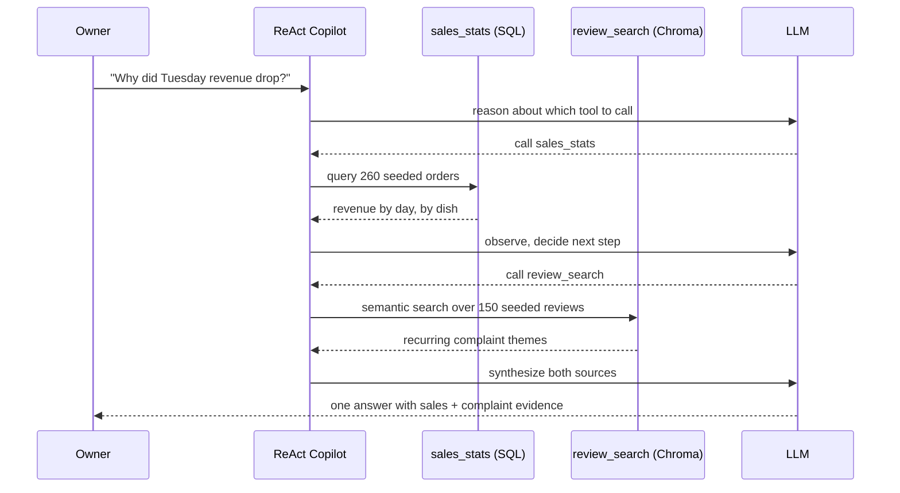
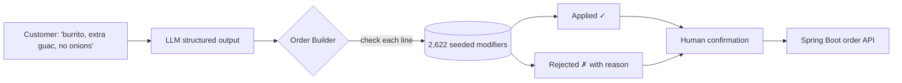

<p align="center">
  
</p>

<h1 align="center">🌮 FoodPilot AI</h1>

<p align="center">
  <strong>An AI-native operating platform for mobile food businesses.</strong><br/>
  A food-truck marketplace with an <em>AI concierge</em> for customers and an <em>AI operations copilot</em> for owners —
  built as a forcing function to learn the whole modern agent stack, from LangChain to LangGraph to production microservices.
</p>

<p align="center">
  
  
  
  
  
  
  
</p>

---

## The hard part

An LLM will produce perfectly valid JSON for a burrito with a modifier that does not exist on the menu.
Valid structure is not a valid order, and in a marketplace that difference shows up as a customer who
paid for something the truck cannot make.

The second one: an owner's real question — *why did Tuesday drop?* — never lives in one data source.
The revenue is in SQL. The reason is in free-text reviews.

---

## Highlights

- Architected a food-truck platform with **2 Next.js apps**, a **Spring Boot** transaction API, and a **FastAPI** AI service to keep model-heavy reasoning off order workflows, isolating LangChain agents from the backend handling sales and order transactions.
- Engineered a **ReAct owner copilot** that unifies sales and review analysis, routing questions to a SQL `sales_stats` tool or Chroma-based RAG `review_search` across **260 seeded orders** and **150 seeded reviews**, so owners ask one question instead of checking **2 dashboards**.
- Validated LLM-generated order lines against **2,622 seeded menu modifiers** with a deterministic **Order Builder**, checking whether requested options actually exist rather than trusting valid JSON, and returning applied or rejected changes with reasons before the customer confirms.
- Built an **AI Concierge** that converts natural language into a validated `FoodQuery` through **2 structured-output paths**, then retrieves from **635 dishes** using Chroma `bge-m3` embeddings plus exact metadata filters for diet, price, spice and protein.
- Ranked recurring complaints with **map-reduce RAG** over **150 raw reviews** using LangChain `.batch()`, producing owner-ready review intelligence instead of one-shot retrieval.
- Turned sales targets into prep plans with an **LCEL workflow** that joins **179 ingredients** with **1,887 recipes** to compute ingredient requirements, shortfalls and supplier needs.
- Hid **2 model backends** (ASU CreateAI and local Ollama `qwen3:4b`) behind a provider factory with graceful local mocks, so customer, owner, order and analytics flows stay reviewable when AI is offline.
- Added a standalone Python import utility that validates and **deduplicates** incoming order records before they reach live order processing, so re-submitted batches cannot double-process.

> All marketplace data is **seeded**: 107 trucks, 635 dishes, 2,622 modifiers, 260 orders, 150 reviews, 179 ingredients, 1,887 recipes. This is a portfolio build, not a production system with real customers.

---

## Agent design

| Layer | How it works here |
|---|---|
| **Orchestration** | A **ReAct** owner copilot picks tools per question, with LCEL chains for the deterministic workflows. The tool loop was written by hand first and only then replaced with a prebuilt agent, so the failure modes were visible before they were abstracted away |
| **Tool interfaces** | 2 tools with distinct jobs — a SQL `sales_stats` tool over 260 seeded orders, and a vector `review_search` tool over 150 seeded reviews |
| **Retrieval** | Chroma `bge-m3` embeddings across 635 dishes combined with exact metadata filters for diet, price, spice and protein, so fuzzy taste and hard constraints are both respected |
| **Structured output** | Natural language is converted into a validated `FoodQuery` through 2 structured-output paths before anything touches the catalogue |
| **Guardrails** | A deterministic **Order Builder** checks every generated line against 2,622 seeded modifiers and returns each one applied or rejected **with a reason**. A human confirms before checkout |
| **Reporting** | Complaint ranking is map-reduce RAG with LangChain `.batch()` over 150 raw reviews, not one retrieval call pretending to be a report |
| **When it breaks** | 2 model backends behind a provider factory, plus local mocks, so the customer, owner, order and analytics flows stay reviewable with AI offline |

---

## Architecture



## The owner copilot loop



## Order validation



---

## Services

| Service | Port | Responsibility |
|---|---|---|
| `web/` | 3000 | Customer concierge + owner operations, Next.js 16, D3.js + Recharts |
| `app/` | 8080 | Spring Boot 3 transaction API — orders, sales analytics, JDBC, HikariCP |
| `ai_service/` | 8000 | FastAPI + LangChain/LangGraph — concierge, copilot, order builder, prep planner |
| `gateway/` | — | Routing between the product surfaces and the two backends |
| `data/` | — | Seeded Yelp-style marketplace dataset |

## Tech stack

**Frontend** Next.js 16 · React · TypeScript · Tailwind CSS · Framer Motion · D3.js · Recharts
**Transactions** Java · Spring Boot 3 · Spring Web · Spring JDBC · HikariCP
**AI** Python · FastAPI · Uvicorn · LangChain · LangGraph · LCEL · ReAct tool calling · Pydantic structured output
**Data** Chroma (bge-m3) · SQLite · Tableau-ready exports

## Quick start

```bash
git clone https://github.com/Brijesh03032001/foodai.git
cd foodai
```

```bash
cd ai_service && pip install -r requirements.txt && uvicorn main:app --port 8000
```

```bash
cd app && ./mvnw spring-boot:run
```

```bash
cd web && npm install && npm run dev
```

---

## 🧩 Part of a series on agents that take actions

|  |  |
|---|---|
| [**SlackAgent**](https://github.com/Brijesh03032001/SlackAgent) | 59 tools across 3 apps through one MCP client |
| [**Aria**](https://github.com/Brijesh03032001/Aria) | 5 agents behind a LangGraph supervisor, gated on spoken confirmation |
| [**FoodPilot AI**](https://github.com/Brijesh03032001/foodai) | A ReAct copilot plus a validator the LLM cannot talk past  ←  **you are here** |
| [**TrustMed-AI**](https://github.com/Brijesh03032001/TrustmedAi) | Retrieval you can audit, with an evaluation suite behind it |

How I build these, end to end → **[github.com/Brijesh03032001](https://github.com/Brijesh03032001)**

---

**Built by [Brijesh Kumar](https://github.com/Brijesh03032001)** · [Portfolio](https://brijeshbuilds.com) · [LinkedIn](https://linkedin.com/in/brijeshkumar03)
